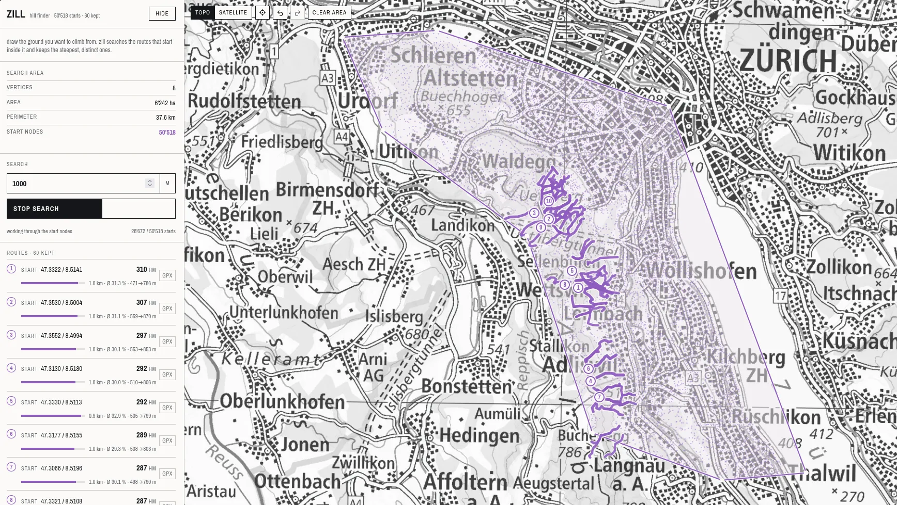

# Zill

Generates graphs from OpenStreetMap data optimized for elevation-based routing. Check out the interactive dashboard at [https://zl.rkma.dev](https://zl.rkma.dev) to find the steepest routes near you!



## Structure

Three subprojects in one repo:

- `convert/` (`zillconv`) - Converts OSM data into a `.zl` file. _Requires PROJ and expat as a system dependency._
- `find/` (`zill`) - Loads the `.zl` file and runs graph algorithms on it. _Has no dependencies._
- `dashboard/` - Web UI (SolidJS + MapLibre) that draws concave search areas and shows the steepest routes on an interactive map of Switzerland. The `find` library runs in the browser as WebAssembly, so the search happens entirely client-side.

Each Zig subproject is a standalone project with its own `build.zig` and `build.zig.zon`. `convert` uses the graph library from `find` through a Zig path dependency (`convert/build.zig.zon`). `data/` and `dist/` are shared at the repo root.

`.zl` is a custom binary format to store the graph data in a compact way. It does not follow the OSM data model of nodes and ways directly; only nodes are stored that are either part of an intersection or mark the beginning or end of a way (and, at 100 m chunking, points every ~100 m along longer ways). The file is a 24-byte header followed by nine typed sections — a "struct of arrays" layout, each section aligned to its element size, so a reader takes typed slices straight out of the file and never parses a record (view `find/src/graph/shared.zig` for the exact layout):

- **Header:** node count, edge count, the `ZILL` magic, and the Zill version the file was generated with.
- **Nodes (18 bytes each, four sections):** `i64` OSM node id, `f32` latitude, `f32` longitude, `u16` elevation (`0xFFFF` = unknown).
- **Edges (16 bytes each, five sections):** `u32` endpoints — _indices_ of nodes `u` and `v`, not OSM ids — plus total elevation gain, loss, and distance from `u` to `v`. Each segment is stored once; the reverse direction is derived on read. Elevation and distance are accumulated to include intermediate nodes along the original OSM ways, which keeps route elevation accurate but makes a GPX of a route cut corners between stored nodes.

> [!NOTE]
> [Releases page](https://github.com/markbeep/zill/releases) includes pre-generated `.zl` files.

## Building

Run everything from the repo root through the [`justfile`](justfile), so the `data/` paths in the defaults resolve:

```sh
just          # build both Zig subprojects
just test     # run both test suites
just generate # convert OSM data into a .zl file
just dist     # cross-compile release binaries into dist/
just wasm     # build the browser module (find/zig-out/bin/zill.wasm)
just wasm-smoke # smoke-test that module in node
just graph    # package data/<name>.zl as <name>.zl.tar.gz for the browser
```

The recipes are thin wrappers around `zig build --build-file <subproject>/build.zig`. They must run from the repo root: the executables and tests resolve `data/` relative to the working directory.

## Graph Algorithms

There are two variants. You can either find:

- the maximum elevation under a given distance `--max-distance`
- the minimum distance required to reach a point `--max-elevation` higher than the start (can be very slow and find extremely long distances if there are no close-by climbs)

```
Usage: zill [options]

Options:
  -i, --input-path      Path to the input graph file. Default: data/graph.zl
  -d, --max-distance    Maximum total distance (in m) path to compute. Default: null
  -e, --max-elevation   Maximum total elevation path (in m) to compute. Default: null
  -r, --max-radius      Maximum radius (in m) to consider for starting nodes. Default: 100
  -a, --area            Search area as "lat,lon;lat,lon;..." (concave allowed). Overrides --max-radius
      --lat             Latitude of the starting point. Default: 47.38300076849868
      --lon             Longitude of the starting point. Default: 8.539661719099556
  -t, --max-threads     Maximum number of threads to use. Default: null (all)
      --results         Number of results to save. Default: 5
      --dedup           Overlap above which two routes count as the same climb (0..1, >= 1 disables). Default: 0.5
  -h, --help            Show this help message
```

```sh
just run -- -i data/switzerland_walkable_100m.zl -d 1000
just run -- -i data/switzerland_walkable_100m.zl -d 8000 -t 8 \
    --area "47.192,9.328;47.192,9.352;47.212,9.340"
```

### Duplicate routes

Many start nodes sit metres apart on the same climb, and without filtering the result list fills up
with the same route from a dozen neighbouring junctions. `zill` drops a candidate when it overlaps
an already kept route by more than `--dedup`: the overlap is the share of the shorter route's
distance that both routes walk, measured on hops that connect the same two places within ~33 m
(node positions are snapped to a grid and neighbouring cells count, so two starts 10 m apart count
as one place even when they are different graph nodes). A weaker candidate is dropped when it
overlaps a kept route, but a stronger one replaces the route it overlaps, so the ranking does not
depend on the order the start nodes happen to be visited in. Candidates that gain less than 50 m are not
climbs and never enter the ranking, unless nothing in the area reaches that floor: a small or flat
area then ranks the strongest lines its distance allows, with honest small gains instead of an empty
list. The count of suppressed candidates is printed.

## Dashboard

`dashboard/` is the browser front end: SolidJS, TypeScript, MapLibre GL, and the `find` library
compiled to `wasm32-freestanding` and driven from a Web Worker. Nothing is computed on a server and
the graph never leaves the browser.

```sh
cd dashboard
npm install
npm run dev     # http://localhost:5173
```

Two assets must exist before the first run, and the recipes that build them link both into
`dashboard/public/`, which is what the dev server serves:

```sh
just wasm    # find/zig-out/bin/zill.wasm
just graph   # data/switzerland_walkable_100m.zl.tar.gz (~66 MB, 3.9M nodes)
```

## Convert - Generate .zl file from OSM data

If you want to generate your own `.zl` file, you can use the `convert/` subproject (`zillconv`). It depends on [PROJ](https://proj.org/) to convert the coordinates from WGS84 to Swiss coordinate system (EPSG:21781) and [expat](https://libexpat.github.io/) to parse the OSM XML data. End goal would be to fully remove these system dependencies and build everything with the Zig build system.

### Generating graph.zl

Requires `proj.db` for now.

```sh
PROJ_DATA=/usr/share/proj just generate
```

### Elevation Map

Requires [GDAL](https://gdal.org/en/stable/download.html#binaries) to convert the coarse elevation data from SwissTopo into a GeoTIFF.

1. Download coarse elevation data from [SwissTopo](https://www.swisstopo.admin.ch/de/hoehenmodell-dhm25#DHM25---Download).
2. Convert the `.asc` into `.tif`.

```sh
curl -f -o /tmp/dhm25.zip "https://cms.geo.admin.ch/ogd/topography/DHM25_MM_ASCII_GRID.zip"
unzip -q -j /tmp/dhm25.zip -d /tmp/dhm25

gdal_translate \
    -a_srs EPSG:21781 \
    -a_nodata -9999 \
    -co TILED=YES \
    -co COMPRESS=DEFLATE \
    -co PREDICTOR=2 \
    -co BIGTIFF=IF_SAFER \
    /tmp/dhm25/dhm25_grid_raster.asc \
    data/switzerland_dhm25.tif
```

### OSM Extraction

https://download.geofabrik.de/europe/switzerland.html
